# Agent graph

Generated from the code with `router_graph.get_graph(xray=True).draw_mermaid()` (regenerated in Phase 5, 2026-11-23). Regenerate it after changing a graph:

```bash
DATABASE_URL=sqlite:///./test.db GROQ_API_KEY=x venv/Scripts/python -c "from app.agents.router import router_graph; print(router_graph.get_graph(xray=True).draw_mermaid())"
```

What to look for:
- **Subgraphs:** `product_agent`, `order_agent` and `support_agent` each declare their own input and output state (`app/agents/state.py`). `safety_handoff` and `ticket_handoff` are the same escalation subgraph: open a ticket, then alert a person.
- **The loop:** inside `product_agent`, `find_products` runs `plan_search → search → loosen → search …` until something matches, at most 1 + 4 searches.
- **The tool loop (Phase 5, ADR 0016):** inside `product_agent`, `answer_question` runs `qa_think → qa_tools → qa_think …`: the model calls read-only product tools through a `ToolNode`, at most 3 rounds, then `qa_answer`.
- **The pause:** `support_agent:confirm_cancel` calls `interrupt()`. The graph stops there, and the thread is saved by the Postgres checkpointer, until the shopper presses Yes or No. Only `cancel_order` (plain Python, owner and status re-checked) changes the order.
- **No model on the chip path:** a removed filter chip enters at `__start__ → product_agent → apply_filter_edit` and is ranked by `order_by_score`, skipping `classify`, `extract_preferences` and `rank_products`.
- Model calls happen only in `classify`, `extract_preferences`, `rank_products` and `draft_resolution`.

```mermaid
---
config:
  flowchart:
    curve: linear
---
graph TD;
	__start__([<p>__start__</p>]):::first
	classify(classify)
	clarify(clarify)
	sign_in(sign_in)
	safety(safety)
	safety_reply(safety_reply)
	__end__([<p>__end__</p>]):::last
	__start__ -.-> classify;
	__start__ -.-> product_agent\3a__start__;
	classify -.-> clarify;
	classify -. &nbsp;order&nbsp; .-> order_agent\3afind_order;
	classify -. &nbsp;product&nbsp; .-> product_agent\3a__start__;
	classify -.-> safety;
	classify -.-> sign_in;
	classify -. &nbsp;support&nbsp; .-> support_agent\3afind_order;
	safety --> safety_handoff\3aopen_ticket;
	safety_handoff\3anotify --> safety_reply;
	clarify --> __end__;
	order_agent\3a__end__ --> __end__;
	product_agent\3a__end__ --> __end__;
	safety_reply --> __end__;
	sign_in --> __end__;
	support_agent\3a__end__ --> __end__;
	subgraph safety_handoff
	safety_handoff\3aopen_ticket(open_ticket)
	safety_handoff\3anotify(notify)
	safety_handoff\3aopen_ticket --> safety_handoff\3anotify;
	end
	subgraph product_agent
	product_agent\3a__start__(<p>__start__</p>)
	product_agent\3aextract_preferences(extract_preferences)
	product_agent\3aapply_filter_edit(apply_filter_edit)
	product_agent\3aorder_by_score(order_by_score)
	product_agent\3aask_for_preferences(ask_for_preferences)
	product_agent\3arespond_unavailable(respond_unavailable)
	product_agent\3arank_products(rank_products)
	product_agent\3aformat_recommendations(format_recommendations)
	product_agent\3arespond_no_results(respond_no_results)
	product_agent\3a__end__(<p>__end__</p>)
	product_agent\3a__start__ -. &nbsp;qa&nbsp; .-> product_agent\3aanswer_question\3a__start__;
	product_agent\3a__start__ -. &nbsp;edit&nbsp; .-> product_agent\3aapply_filter_edit;
	product_agent\3a__start__ -. &nbsp;extract&nbsp; .-> product_agent\3aextract_preferences;
	product_agent\3aapply_filter_edit -. &nbsp;ask&nbsp; .-> product_agent\3aask_for_preferences;
	product_agent\3aapply_filter_edit -. &nbsp;search&nbsp; .-> product_agent\3afind_products\3aplan_search;
	product_agent\3aapply_filter_edit -. &nbsp;unavailable&nbsp; .-> product_agent\3arespond_unavailable;
	product_agent\3aextract_preferences -. &nbsp;ask&nbsp; .-> product_agent\3aask_for_preferences;
	product_agent\3aextract_preferences -. &nbsp;search&nbsp; .-> product_agent\3afind_products\3aplan_search;
	product_agent\3aextract_preferences -. &nbsp;unavailable&nbsp; .-> product_agent\3arespond_unavailable;
	product_agent\3afind_products\3a__end__ -. &nbsp;score&nbsp; .-> product_agent\3aorder_by_score;
	product_agent\3afind_products\3a__end__ -. &nbsp;rank&nbsp; .-> product_agent\3arank_products;
	product_agent\3aorder_by_score -. &nbsp;recommend&nbsp; .-> product_agent\3aformat_recommendations;
	product_agent\3aorder_by_score -. &nbsp;no_results&nbsp; .-> product_agent\3arespond_no_results;
	product_agent\3arank_products -. &nbsp;recommend&nbsp; .-> product_agent\3aformat_recommendations;
	product_agent\3arank_products -. &nbsp;no_results&nbsp; .-> product_agent\3arespond_no_results;
	product_agent\3aanswer_question\3aqa_answer --> product_agent\3a__end__;
	product_agent\3aask_for_preferences --> product_agent\3a__end__;
	product_agent\3aformat_recommendations --> product_agent\3a__end__;
	product_agent\3arespond_no_results --> product_agent\3a__end__;
	product_agent\3arespond_unavailable --> product_agent\3a__end__;
	subgraph find_products
	product_agent\3afind_products\3aplan_search(plan_search)
	product_agent\3afind_products\3asearch(search)
	product_agent\3afind_products\3aloosen(loosen)
	product_agent\3afind_products\3a__end__(<p>__end__</p>)
	product_agent\3afind_products\3aloosen --> product_agent\3afind_products\3asearch;
	product_agent\3afind_products\3aplan_search --> product_agent\3afind_products\3asearch;
	product_agent\3afind_products\3asearch -. &nbsp;done&nbsp; .-> product_agent\3afind_products\3a__end__;
	product_agent\3afind_products\3asearch -.-> product_agent\3afind_products\3aloosen;
	end
	subgraph answer_question
	product_agent\3aanswer_question\3a__start__(<p>__start__</p>)
	product_agent\3aanswer_question\3aqa_think(qa_think)
	product_agent\3aanswer_question\3aqa_tools(qa_tools)
	product_agent\3aanswer_question\3aqa_answer(qa_answer)
	product_agent\3aanswer_question\3a__start__ --> product_agent\3aanswer_question\3aqa_think;
	product_agent\3aanswer_question\3aqa_think -.-> product_agent\3aanswer_question\3aqa_answer;
	product_agent\3aanswer_question\3aqa_think -.-> product_agent\3aanswer_question\3aqa_tools;
	product_agent\3aanswer_question\3aqa_tools --> product_agent\3aanswer_question\3aqa_think;
	end
	end
	subgraph order_agent
	order_agent\3afind_order(find_order)
	order_agent\3aorder_status(order_status)
	order_agent\3arespond_not_found(respond_not_found)
	order_agent\3arespond_no_orders(respond_no_orders)
	order_agent\3alist_orders(list_orders)
	order_agent\3a__end__(<p>__end__</p>)
	order_agent\3afind_order -. &nbsp;list&nbsp; .-> order_agent\3alist_orders;
	order_agent\3afind_order -. &nbsp;status&nbsp; .-> order_agent\3aorder_status;
	order_agent\3afind_order -. &nbsp;no_orders&nbsp; .-> order_agent\3arespond_no_orders;
	order_agent\3afind_order -. &nbsp;not_found&nbsp; .-> order_agent\3arespond_not_found;
	order_agent\3alist_orders --> order_agent\3a__end__;
	order_agent\3aorder_status --> order_agent\3a__end__;
	order_agent\3arespond_no_orders --> order_agent\3a__end__;
	order_agent\3arespond_not_found --> order_agent\3a__end__;
	end
	subgraph support_agent
	support_agent\3afind_order(find_order)
	support_agent\3aanswer_policy(answer_policy)
	support_agent\3aask_for_order(ask_for_order)
	support_agent\3ahandle_cancellation(handle_cancellation)
	support_agent\3aconfirm_cancel(confirm_cancel)
	support_agent\3acancel_order(cancel_order)
	support_agent\3akeep_order(keep_order)
	support_agent\3acreate_ticket(create_ticket)
	support_agent\3aticket_reply(ticket_reply)
	support_agent\3adraft_resolution(draft_resolution)
	support_agent\3a__end__(<p>__end__</p>)
	support_agent\3aconfirm_cancel -. &nbsp;cancel&nbsp; .-> support_agent\3acancel_order;
	support_agent\3aconfirm_cancel -. &nbsp;keep&nbsp; .-> support_agent\3akeep_order;
	support_agent\3acreate_ticket -. &nbsp;done&nbsp; .-> support_agent\3a__end__;
	support_agent\3acreate_ticket -. &nbsp;escalate&nbsp; .-> support_agent\3aticket_handoff\3aopen_ticket;
	support_agent\3afind_order -. &nbsp;policy&nbsp; .-> support_agent\3aanswer_policy;
	support_agent\3afind_order -. &nbsp;ask_order&nbsp; .-> support_agent\3aask_for_order;
	support_agent\3afind_order -. &nbsp;ticket&nbsp; .-> support_agent\3acreate_ticket;
	support_agent\3afind_order -. &nbsp;draft&nbsp; .-> support_agent\3adraft_resolution;
	support_agent\3afind_order -. &nbsp;cancel&nbsp; .-> support_agent\3ahandle_cancellation;
	support_agent\3ahandle_cancellation -. &nbsp;done&nbsp; .-> support_agent\3a__end__;
	support_agent\3ahandle_cancellation -. &nbsp;confirm&nbsp; .-> support_agent\3aconfirm_cancel;
	support_agent\3aticket_handoff\3anotify --> support_agent\3aticket_reply;
	support_agent\3aanswer_policy --> support_agent\3a__end__;
	support_agent\3aask_for_order --> support_agent\3a__end__;
	support_agent\3acancel_order --> support_agent\3a__end__;
	support_agent\3adraft_resolution --> support_agent\3a__end__;
	support_agent\3akeep_order --> support_agent\3a__end__;
	support_agent\3aticket_reply --> support_agent\3a__end__;
	subgraph ticket_handoff
	support_agent\3aticket_handoff\3aopen_ticket(open_ticket)
	support_agent\3aticket_handoff\3anotify(notify)
	support_agent\3aticket_handoff\3aopen_ticket --> support_agent\3aticket_handoff\3anotify;
	end
	end
	classDef default fill:#f2f0ff,line-height:1.2
	classDef first fill-opacity:0
	classDef last fill:#bfb6fc
```


